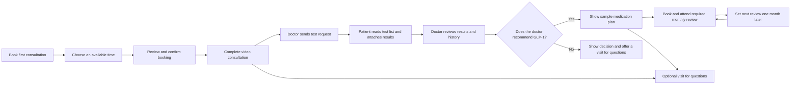

# Smallsteps UX handoff

The Requirements Elicitation Summary defines the product backlog. R11 records the product owner’s later clarification on the order of care. R12 records the simplified booking flow.

## Requirements and stories

| ID | Requirement |
|---|---|
| R1 | Digital care intake, lab screening and doctor consultation |
| R2 | One-to-one video consultation |
| R3 | Doctor reviews results and records a medication recommendation |
| R4 | Dietitian meal plan builder |
| R5 | Weight and symptom tracking |
| R6 | Appointment reminders |
| R7 | Lab report upload and review |
| R8 | Clear monthly costs |
| R9 | Booking confirmation with a reference and appointment management |
| R11 | First doctor consultation, then doctor-requested tests, report review and a GLP-1 decision. Required doctor reviews each month on GLP-1 and separate optional visits. |
| R12 | Show only available appointment times. Continue directly to review and confirmation without an availability check or failure screen. |

| Story | What the user needs | Acceptance check | Requirements |
|---|---|---|---|
| US01 | Start with a doctor and learn which tests to take. | The first booking asks for the visit reason. Tests and report upload appear only after the completed first visit and doctor request. | R1, R7, R11 |
| US02 | Choose a time for a doctor appointment. | The screen shows only open times. Selecting a date and time opens the booking review directly. | R1, R2, R9, R12 |
| US04 | Confirm or manage a booking. | Confirmation displays a reference. Regular visits can be cancelled. Monthly reviews can be moved without losing the existing booking before confirmation. | R9, R11 |
| US05 | Join a video appointment. | Joining and finishing the demo call opens the visit summary. | R2, R11 |
| US06 | Record the doctor’s GLP-1 decision. | The doctor needs an attached report and review acknowledgement. An eligible decision shows the fixed sample dose. A decision against GLP-1 shows the outcome without the dose. | R3, R7, R11 |
| US07 | Share and follow a weekly meal plan. | Changes published in the dietitian view appear in the patient plan. | R4 |
| US08 | Track weight and symptoms. | Saving a check-in updates the list and weight history. | R5 |
| US09 | Understand costs and manage reminders. | Membership lists fees and exclusions. Reminder preference persists after reload. | R6, R8 |
| US10 | Submit results for the tests the doctor requested. | The patient sees the request and can attach a sample result. The filename appears in Doctor review. | R7, R11 |
| US11 | Attend a required monthly doctor review. | A GLP-1 recommendation sets the first due date. Finishing a monthly review sets another due date one calendar month later. | R2, R11 |
| US12 | Book an extra visit for questions. | The patient can book and complete an optional visit separately. This leaves the monthly booking and due date in place. | R2, R11 |

## Patient and doctor flow

The same booking, review and confirmation screens are reused for all three visit types. The booking screen hides occupied times. The overview shows the patient’s current step. Tests & reports shows the doctor’s test names before the upload action. Medication shows the decision status until the doctor shares a result. The monthly review and optional appointments remain distinct on the Consultations screen.

## Prototype limits

The demo uses fictional profiles and example dates. Uploaded files are represented by their filenames. A doctor selects a fixed example decision in the demo, so the prototype does not interpret reports, decide eligibility automatically or issue a prescription. It uses a browser-only sample record. Links to the video room, billing and reminders demonstrate the interface. The walkthrough starts in the patient workspace, then switches to Doctor review for the test request and eligibility decision.
