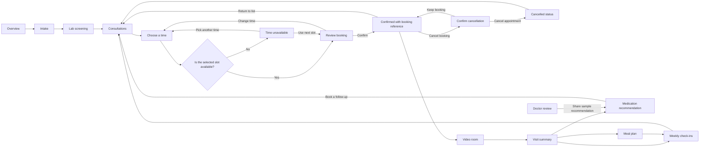

# Smallsteps UX handoff

The guest speaker’s *Student UX Prompt Kit* supplies the four-stage method. The *Requirements Elicitation Summary: Online Weight Loss Platform* supplies the product scope. Backlog IDs below were derived from that brief. The primary task is booking an initial video visit for GLP-1 telemedicine. The recovery scenario is a slot taken between selection and confirmation. The prototype uses fictional names, dates, reports and illustrative prices.

## 1. Requirements to stories and flow

| ID | Source requirement or prompt |
|---|---|
| R1 | Workshop 1: digital intake and lab screening followed by video consultation |
| R2 | MVP: secure 1-on-1 video call room |
| R3 | MVP: e-prescriptions with safety checklist |
| R4 | MVP: weekly meal plan builder (dietitian view) |
| R5 | MVP: weight and symptom tracking log |
| R6 | MVP: automated reminders (SMS/push) |
| R7 | MVP: lab report uploader and trend view |
| R8 | MVP: transparent monthly subscription billing |
| R9 | UX kit: availability check, unavailable slot, recover or reselect, confirm with reference, cancel |
| R10 | Should: secure messaging and AI diet plan. Could: community forum. Phase 1 exclusion: smartwatch sync. |

| ID | User story | Testable acceptance criteria | Source | Priority |
|---|---|---|---|---|
| US01 | As a patient, I want to share intake and sample labs so my doctor can review my context. | Given the intake, when I submit it, then the lab step opens. Given an attached sample, when the doctor opens review, then its filename appears. | R1, R7 | Must |
| US02 | As a patient, I want to select a consultation so I can book around work. | Given a different date, when I select its tab, then the visit list reflects the chosen date. Given a visit and time, when I check an available slot, then the review screen shows those details. | R1, R2, R9 | Must |
| US03 | As a patient, I want to recover from a full time slot so I can finish booking without re-entering my topic. | Given Monday at 10:00 AM, when I check availability, then I see the unavailable screen after a loading state. Given that screen, when I take the suggestion, then review shows 12:30 PM. When I instead return to times, then 10:00 AM is disabled and my topic remains. | R9 | Must |
| US04 | As a patient, I want a booking reference and the option to cancel so I can manage the appointment. | Given an available visit on review, when I confirm, then the booking shows Confirmed and an SS reference. Given a confirmed visit, when I confirm cancellation, then the status changes to Cancelled and the list no longer shows it as booked. | R9 | Must |
| US05 | As a patient, I want to join a video visit and find my next steps so I can continue care. | Given a confirmed appointment, when I join, then the room shows the simulated visit in progress. When I finish the visit, then the summary links to nutrition and progress. | R1, R2 | Must |
| US06 | As a doctor, I want to share a semaglutide recommendation after a safety review so the patient can see the dose and follow-up plan. | Given an incomplete checklist, sharing is blocked. Given all checks completed, when I share the sample, the patient Medication screen shows Shared in demo. Given the Medication screen, the patient can see the drug, dose, schedule, route and follow-up note. | R3 | Must |
| US07 | As a dietitian, I want to publish a weekly meal plan so my patient can follow it. | Given an edited meal, when I publish, then the patient view shows the updated item. Given a prep note, when I publish, then the note appears alongside the plan. | R4 | Must |
| US08 | As a patient, I want to log a weight and symptom so I can discuss patterns in follow-ups. | Given a valid weight and symptom, when I submit, then both appear in recent entries. After saving, the latest weight and trend update. | R5 | Must |
| US09 | As a patient, I want to control reminders and understand costs so I can decide whether to subscribe. | Given Membership, the monthly amount and exclusions are visible. When I change the SMS preference and save, then it persists after reload. | R6, R8 | Must |
| US10 | As a patient, I want to view sample lab dates and results so I can discuss changes with my doctor. | Given Lab reports, the screen lists two dated sample results. Given a demo PDF or image, when I attach it, then the screen shows its filename. | R7 | Must |

| Flow nodes | Story | Requirement |
|---|---|---|
| A–C | US01 | R1, R7 |
| D–G, availability yes and change time | US02 | R1, R2, R9 |
| F–H, availability no and both recovery routes | US03 | R9 |
| I–K, return and cancel branches | US04 | R9 |
| L–M | US05 | R1, R2 |
| N–O | US07, US08 | R4, R5 |
| Q, P and the follow-up branch | US06, US02 | R3, R1, R9 |
| Dietitian workspace and patient plan | US07 | R4 |
| Membership and reminder preference | US09 | R6, R8 |
| Lab reports | US10 | R7 |

R10 is outside the implemented scope. Open questions include who approves final pricing, the production cancellation window, who reviews flagged lab results, actual reminder timing and accessibility acceptance in supported assistive technologies.

## 2. Wireframe structure at 375 × 812

Use a shared top bar, title, stacked detail blocks, primary action and back link. Use the same form labels and action order in the finished screens. Decision F appears as a loading state inside E and then routes to G or H.

| Flow node | Screen structure, in reading order | Primary action |
|---|---|---|
| A | Header, welcome, care visit hero, overview links | Start intake |
| B | Back, intake title and progress, name, weight, goal, notes | Continue to lab screening |
| C | Back, title and progress, current attachment, report actions | Choose a consultation |
| D | Title, status if present, date buttons, doctor rows | View times |
| E | Back, title and progress, doctor, topic, slot selections | Check availability |
| H | Back, title, unavailable time, explanation, suggested time and secondary choice | Use 12:30 PM |
| G | Back, title and progress, doctor, slot and topic, change link | Confirm booking |
| I | Back, confirmed status, time, reference, topic, cancel and return | Open video room |
| J | Modal, impact of cancellation and keep option | Cancel appointment |
| K | Back, cancelled status, time, reference, topic | Book another visit |
| L | Back, waiting room or in-progress state, doctor name | Join demo visit / Finish demo visit |
| M | Back, visit state, screening, plan and progress links | Open plan |
| P | Back, medication and dose, frequency, duration, route, doctor note | Book a follow-up |
| Q | Back, sample intake and labs, checklist, preview | Share sample recommendation |
| N | Back, meals, groceries, prep note | Log this week’s check-in |
| O | Back, trend, weight and symptom fields, recent entries | Save check-in |

## 3. High-fidelity design

The finished web screens follow the structure above. The authoring wireframe is a textual specification, and the team has yet to approve separate visual frames. The responsive layout adds a desktop sidebar, retains reading order at 375 px and uses a generated food photograph on the overview.

- Palette: text #24372A, secondary text #556355, background #F8F8F1, card #FFFEF9, primary #314C35, accent #DCE7A3, success surface #DCE7CB, error surface #F5E3DC with text #653A32.
- Typography: Instrument Serif for headings, DM Sans for controls and 16 px body, 14 px field labels.
- Components: neutral and selected date buttons, selectable and disabled appointment slots, status pills with icons and text, report row, meal card and text inputs. Primary controls have a 44 px minimum height. Keyboard focus remains visible.
- Styling changes: overview adds a photo, workflow steps gain labeled chips, availability adds error text, booking uses an explicit status and ref, and the weight view pairs the trend line with values. The core booking states and action order follow the wireframe.
- Measured contrast ratios: body on background 11.90:1, secondary copy on background 5.96:1, primary button 9.37:1, error status 7.67:1, success status 9.87:1 and hero label 5.22:1. Full WCAG 2.2 AA conformance and assistive technology testing are pending.

## 4. Working prototype and walkthrough

Run the Next.js project locally or deploy it to Vercel using the README.

Start at **Overview**, use **Start intake**, and continue through **Lab screening** to **Consultations**. On Monday, November 23, choose the initial screening with Dr. Rania Malik. Select **10:00 AM**, then **Check availability**. After a short check, the time always fails. Choose **Use 12:30 PM** or **Pick another time**. Confirm, locate the SS reference, then open the simulated video room or cancel. Reset the demo to repeat the forced failure.

The patient navigation also opens **Medication**, **Meal plan**, **Progress**, **Lab reports**, and **Membership**. **Care team workspace** provides **Doctor review** and **Meal plan builder**. **Walkthrough guide** on Overview lists participant tasks. Booking status, check-ins, reminders and meal plan changes stay in the browser. The medication recommendation is a fixed example. No live video, prescription, billing or SMS provider is connected. The attachment demo retains a filename only.
